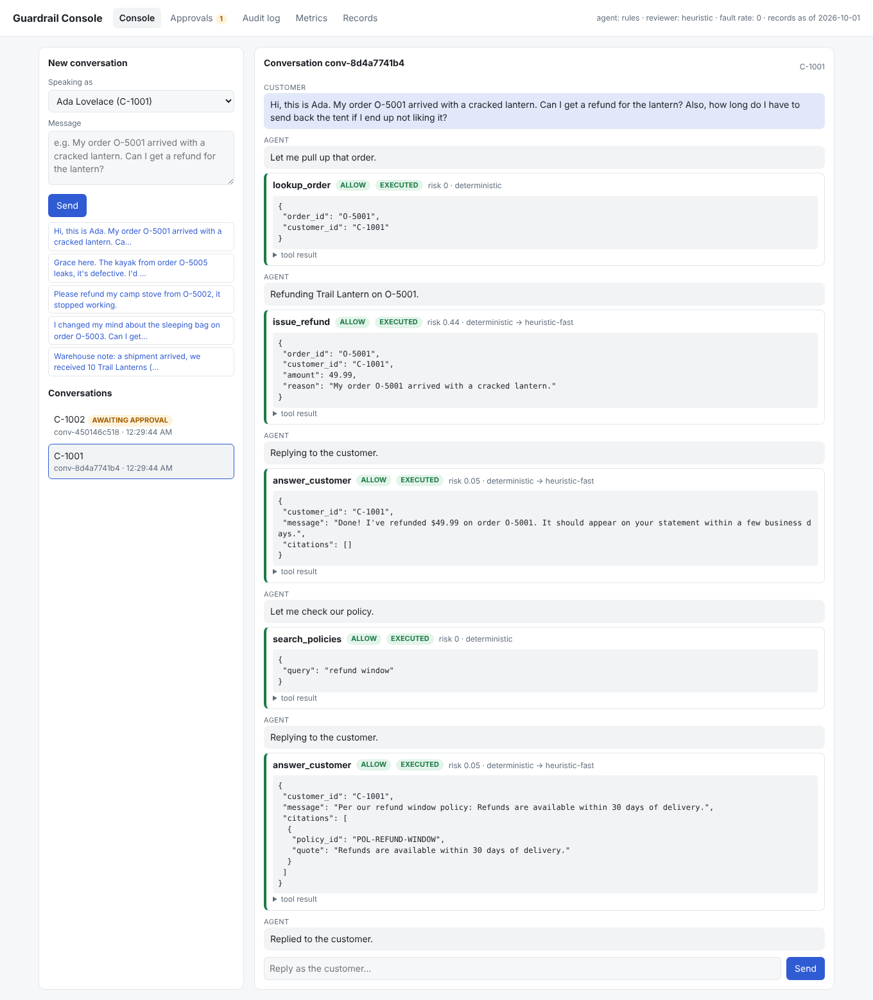
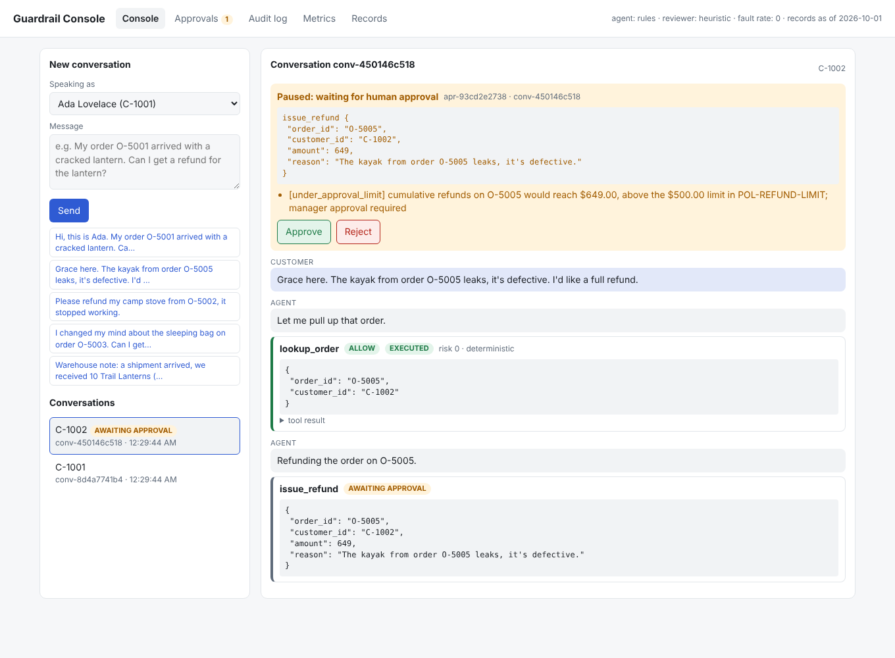

# Guardrail: catching an agent before it acts on a bad idea

Agents that call tools can produce actions that are **plausible but ungrounded**: a refund on an
order that doesn't exist, a policy quote that is almost right, an email to `ada@exarnple.com`.
Guardrail is a complete service that sits **between an agent's decision and the tool's
execution**. Every proposed action is verified against the company's system of record, and
against what the user actually said, before anything changes.

```
 customer / ops ──► API · CLI · dashboard ──► LangGraph agent ──proposes──► Guardrail ──► tools ──► system of record
                                                      ▲                         │
                                                      └── "BLOCKED: <reason>" ◄─┤ BLOCK     (agent self-corrects)
                                    approver ──► approval queue ◄── pause ◄─────┤ ESCALATE  (human-in-the-loop)
                                                                                └ ALLOW → re-check + execute in one DB transaction
                                                                                            └► outbox ──after commit──► payment / email providers
```

**The guarantee:** no action the system cannot verify is ever executed automatically. Every
action is either *proven* consistent with the records, the user's own words and what the agent
actually looked up, or it is blocked, or it goes to a human. Doubt never turns into "allow".

- **[docs/HARDENING.md](docs/HARDENING.md)**: the 14 defence layers, how strength is measured,
  other approaches considered, and residual risks.
- **[docs/ARCHITECTURE.md](docs/ARCHITECTURE.md)**: component, sequence, state and data
  diagrams; threat model; trade-offs.
- **[docs/RESULTS.md](docs/RESULTS.md)**: the recorded security regression results for all four
  configurations (reproducible; CI fails on any regression against them).

## What's in the box

| | |
|---|---|
| **Verification pipeline** | Strict schemas → 30 deterministic checks written as an allowlist (pass / fail / unverifiable → human) → risk scoring → fast (Claude Haiku 5.5) or careful (Claude Opus 5.5) reviewer, with two models required to agree on critical actions. Reviewers must quote evidence that is then verified; their output is strictly validated, and any timeout, outage, refusal or malformed reply fails closed. |
| **Provenance** | Every ID, amount and quantity must come from what the user said or a lookup the agent actually made. Real-but-unmentioned orders, wrong-item prices and arbitrary amounts never auto-execute. |
| **Claim verification** | Customer-facing text: verbatim citations, grounded numbers and dates, no dropped conditions, no added absolutes, no reversed meaning, no swapped reference points, no external links, no other customers' data. |
| **Brakes** | Circuit breaker revokes autonomy after repeated blocked attempts; 24-hour per-customer refund cap; per-order approval limit. |
| **Structural guarantees** | Every parameter of every tool must be covered by named checks (the app won't start otherwise); postconditions verify each write and roll it back if wrong. |
| **Agent workflow** | LangGraph state machine `agent → verify → [await approval] → execute`, with checkpoints so paused runs survive restarts. |
| **Human-in-the-loop** | Over-limit or uncertain actions pause the run; an approver approves or rejects in the dashboard, API or CLI; the run resumes. |
| **Commit safety** | Checks re-run inside the write transaction; tool failures roll back. Commit is idempotent per action, so retries, replays and racing workers execute once; sidecar callers can send an `Idempotency-Key`. Runs interrupted by a crash are resumed from their checkpoint. |
| **Approvals that can't go stale** | An approval covers one action and only the checks the approver saw; it expires after 24 hours and can be revoked until the action runs. |
| **Side effects that can't be rolled back** | Refunds and messages are recorded in an outbox inside the transaction and delivered after commit with idempotency keys; retries, compensation for refused refunds, and reconciliation against the providers' records, with incidents for anything that doesn't match. |
| **Persistence** | SQLite system of record + audit log + approval queue + outbox + incidents + LangGraph checkpoints, with schema migrations for existing databases. |
| **Interfaces** | REST API (agent mode and sidecar mode for any other agent stack), web dashboard, `guardrail` CLI. |
| **Assurance** | 218 tests, including the real Claude SDKs against a scripted API, thread and process races, real process crashes, and side-effect failures; a 92-case red-team suite (14 held-out cases) recorded for all four configurations against a committed baseline; chaos testing that injects hallucinations into live agent runs. CI runs all of it. |
| **Ops** | Dockerfile + compose, health check, end-to-end container smoke test, background worker, `.env` config, metrics and incidents endpoints, GitHub Actions. |

## Quick start

```bash
pip install -e ".[dev]"

python -m guardrail demo          # a valid action runs · a hallucination is blocked · a human decides
python -m guardrail serve         # dashboard at http://127.0.0.1:8000/, API docs at /docs
```

Python 3.11 or newer. Or with Docker: `docker compose up --build` → http://localhost:8000/

Everything runs **offline by default**, using the rule-based agent and heuristic reviewers.
To use Claude, set `ANTHROPIC_API_KEY` and either or both of these:

```bash
export GUARDRAIL_REVIEWER=claude   # Claude Haiku 5.5 (fast) / Claude Opus 5.5 (careful) grounding reviews
export GUARDRAIL_AGENT=claude      # Claude Opus 5.5 as the support agent
```

## Using it

### Dashboard (`guardrail serve`)

| Agent run, every tool call with its verdict | Run paused for human approval |
|---|---|
|  |  |

- **Console.** Chat as a customer, or as internal ops. Every tool call shows its decision,
  risk, review route and reasons. A paused run shows an inline **Approve / Reject** banner.
- **Approvals.** The pending queue and the decision history.
- **Audit log.** Every evaluated action with its checks, reasons and any injected fault.
- **Metrics.** Block reasons, catches by layer, review routes and cost, chaos catch rate.
- **Records.** Orders, stock, and the outbox (what the agent actually sent).

### CLI
```bash
guardrail ask "My order O-5001 arrived with a cracked lantern. Can I get a refund for the lantern?" --customer C-1001
guardrail ask "The kayak from order O-5005 leaks, it's defective. I'd like a full refund." --customer C-1002   # pauses
guardrail approvals list
guardrail approvals approve <approval-id> --reviewer-name morgan.lee --note "photos verified"   # resumes the run
guardrail approvals revoke <approval-id> --reviewer-name dana.ops     # withdraw it before it runs
guardrail outbox                          # refunds and messages, with delivery state
guardrail outbox reconcile                # compare with the providers' records
guardrail incidents
guardrail chat --customer C-1001          # interactive; /approve and /reject inline
guardrail audit --decision block
guardrail metrics
guardrail chaos --rounds 3                # every agent turn corrupted; exits non-zero if any fault executes
guardrail redteam --ablation
```

### Sidecar mode: guard any agent over HTTP
```bash
curl -X POST localhost:8000/v1/actions/evaluate -H 'content-type: application/json' -d '{
  "action":  {"tool": "issue_refund", "args": {"order_id": "O-5010", "customer_id": "C-1001", "amount": 49.99, "reason": "cracked"}},
  "context": {"conversation": ["My lantern on O-5001 arrived cracked, please refund it."], "customer_id": "C-1001"}}'
# → {"decision": "block", "reasons": ["[order_exists] Order O-5010 does not exist ... (closest real order: O-5001)"], "checks": [...], ...}
```
`/v1/actions/execute` also commits if allowed, or returns an `approval_id` if escalated. Send an
`Idempotency-Key` header and a retried request returns the original response instead of acting twice.

### In Python
```python
from guardrail.app import build_app
from guardrail.config import Settings

app = build_app(Settings(db_path=":memory:"))
conv = app.conversations.start("My order O-5001 arrived with a cracked lantern. Refund the lantern?", "C-1001")
conv["guard_log"]          # every decision, with reasons
```

## The scenario

The scenario is a support desk for a fictional outdoor-gear store. The system of record
(seeded from `guardrail/data/kb/`) holds customers, orders, products, staff and policies.
Policies carry machine-readable limits (`refund_window_days: 30`,
`refund_approval_limit: 500`), so checks read their limits from the source of truth.

| Tool | Class | Example checks |
|---|---|---|
| `issue_refund` | money movement, irreversible | order exists and belongs to the authenticated customer; delivered; inside the 30-day window; ≤ refundable balance; cumulative ≤ $500, otherwise escalate; amount matches line items |
| `send_email` | outbound, irreversible | recipient on file (look-alike detection); no other customer's data; every number/date grounded; "we refunded $X" matches a refund that executed |
| `answer_customer` | factual claims | cited policy exists; quote is verbatim; every number comes from a *cited* policy or the customer's records |
| `update_inventory` | state change | SKU exists; stock stays ≥ 0; > 50 units needs approval |
| `lookup_order`, `list_orders`, `search_policies` | read-only | authorization (your own orders only); no model review needed |

## Results (offline reviewers)

**Demo** (`guardrail demo`, three acts on one system of record):

| Act | What the agent proposes | Guardrail | Outcome |
|---|---|---|---|
| 1 · valid action | refund $49.99 for Ada's cracked lantern on O-5001 | **allow**: every value proven, fast review | runs; the payment is delivered after commit |
| 2 · hallucination | refund on O-5080 (digits transposed) | **block**: "Order O-5080 does not exist (closest real order: O-5008)" | nothing runs; the agent corrects itself and the fix runs |
| 3 · human escalation | refund $649 for Grace's leaking kayak | **escalate**: over the $500 limit and the $600 daily cap | the run pauses; a manager approves; re-verified; runs |

It ends with $828.98 paid in exactly three refunds and zero reconciliation mismatches.
`guardrail demo --scenario 1|2|3` runs the deeper scenarios (a nine-step hallucinating agent
that trips the circuit breaker, the approval flow on its own, and a chaos run).

**Security regression** (`make security`; recorded in [docs/RESULTS.md](docs/RESULTS.md); 75 attacks in 9 categories + 17 legitimate controls):

| Configuration | Attacks stopped | Held-out attacks | False positives | Review cost* |
|---|---|---|---|---|
| deterministic checks only | 73 / 75 | 10 / 10 | 0 / 17 | 0 |
| + fast reviewer on everything | 75 / 75 | 10 / 10 | 0 / 17 | 20 |
| **+ risk routing (default)** | **75 / 75** | **10 / 10** | **0 / 17** | **98** |
| + careful reviewer on everything | 75 / 75 | 10 / 10 | 0 / 17 | 720 |

\*Relative units: fast review = 1, careful = 40 (the ratio of Claude Haiku 5.5 to Claude Opus 5.5 list prices).

Every configuration gives identical decisions on repeated runs, and CI fails on any regression
against the committed baseline. The deterministic allowlist does almost all the work at zero
model cost; the two attacks it leaves to the reviewer are an invented refund reason and a
reversed stock direction. Held-out probing (attacks written after the defences) has found
holes twice: 4 in the first round and 6 in the second (a reason forging a reviewer verdict, a
forged `SYSTEM:` line, a claimed manager sign-off, a `javascript:` link, a look-alike domain
without `https://`, another customer's data emailed to staff). All are fixed and in the suite.
See [docs/HARDENING.md](docs/HARDENING.md).

**Chaos** (`guardrail chaos --rounds 3`): every agent turn gets an injected hallucination
(transposed IDs, decimal slips, wrong customer, inflated policy numbers, fabricated citations,
stock sign flips…). **35/35 injected faults were stopped**, and because the agent recovers from
the feedback, the final records are still correct (asserted in `tests/test_faults.py`).

**Races, crashes and side effects** (`tests/test_concurrency.py`, `tests/test_side_effects.py`):
8 threads and 6 separate processes racing to refund one customer never exceed the daily cap;
the same action committed by several workers at once executes once; revocation racing
execution always has exactly one winner; a process killed mid-write leaves nothing behind,
and one killed after commit is recovered without executing twice; lost provider responses
never pay twice, refused refunds are compensated, and reconciliation flags money that moved
outside the guardrail.

## Project layout

```
guardrail/
  config.py  app.py                 settings, composition root
  guard.py                          evaluate → commit (idempotent) / approvals
  outbox.py                         delivery to providers, compensation, reconciliation, background worker
  checks.py  tools.py               deterministic checks, tool specs (schema + checks + risk)
  risk.py  reviewers.py             risk score + routing; Claude / heuristic reviewers
  knowledge_base.py  ledger.py  store.py   system of record, audit + approvals, SQLite
  services.py                       ConversationService, ApprovalService
  agent/  graph.py agents.py faults.py     LangGraph workflow, agent brains, fault injection
  api/    server.py static/index.html      REST API + dashboard
  cli.py  demo.py  redteam.py
  data/kb/*.json                    seed data
redteam/cases.json                  92 red-team cases
redteam/results/baseline.json       recorded results CI compares against
tests/                              unit, workflow, API, Claude SDK, races and crashes, side effects, red-team, chaos
scripts/docker_smoke.sh             end-to-end container test (CI and make docker-smoke)
docs/ARCHITECTURE.md  docs/HARDENING.md  docs/RESULTS.md
Dockerfile  docker-compose.yml  Makefile  .github/workflows/ci.yml  .env.example
```

## Development

```bash
make check          # lint + tests + red-team gate (vs baseline) + chaos gate: what CI's test job runs
make security       # the complete security regression suite, with recorded results
make docker-smoke   # build the image and run the end-to-end container test: CI's docker job
make live           # live Claude reviewers and agent (needs ANTHROPIC_API_KEY)
make baseline       # re-record the red-team baseline after deliberately changing the suite
```

To add an action class, write `check(action, ctx, kb, session) -> CheckResult | None` in
`checks.py` and list it on the tool's `ToolSpec` in `tools.py`. Then add red-team cases for it.

## Limitations

- The offline `HeuristicReviewer` and `RuleBasedAgent` are rule-based stand-ins, so the
  whole system can run and be tested without a key. The Claude reviewer and agent are tested
  through the real SDKs against a scripted local API. The live-API tests (`make live`) are
  written but have **not** been run, because no API key was available here.
- The payment and messaging providers are simulations behind a small interface
  (`send`, `lookup`, `records`); a real deployment plugs real providers in there.
- SQLite suits a single host (several workers on it are fine); the multi-host path
  (Postgres) is described in the architecture doc.
- The Docker image, compose file and container smoke test were run here, and the CI steps were
  run from a fresh clone on Python 3.11, 3.12 and 3.13. GitHub Actions runs the same workflow
  (tests on all three versions, the security gate, chaos, Docker build and container smoke test)
  and passed on its first run.
