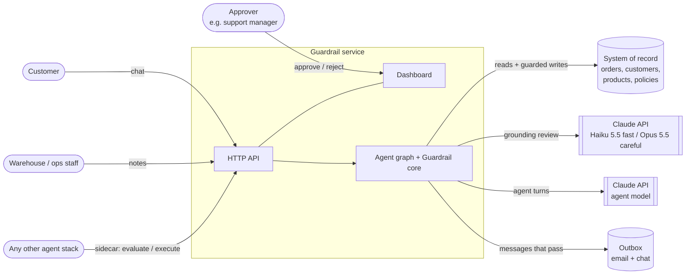
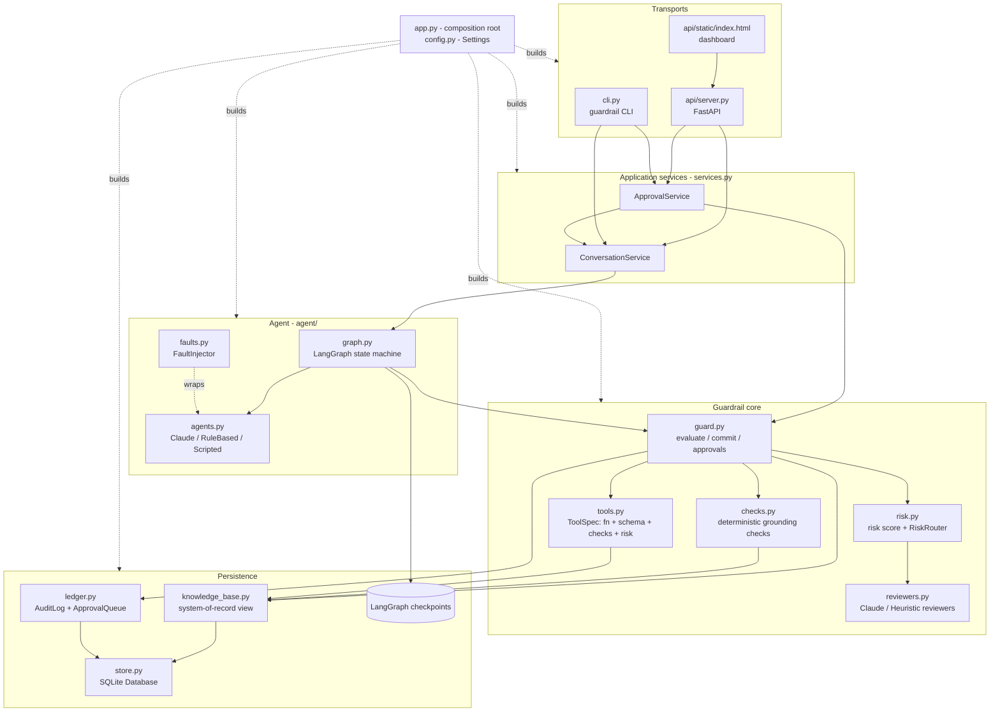
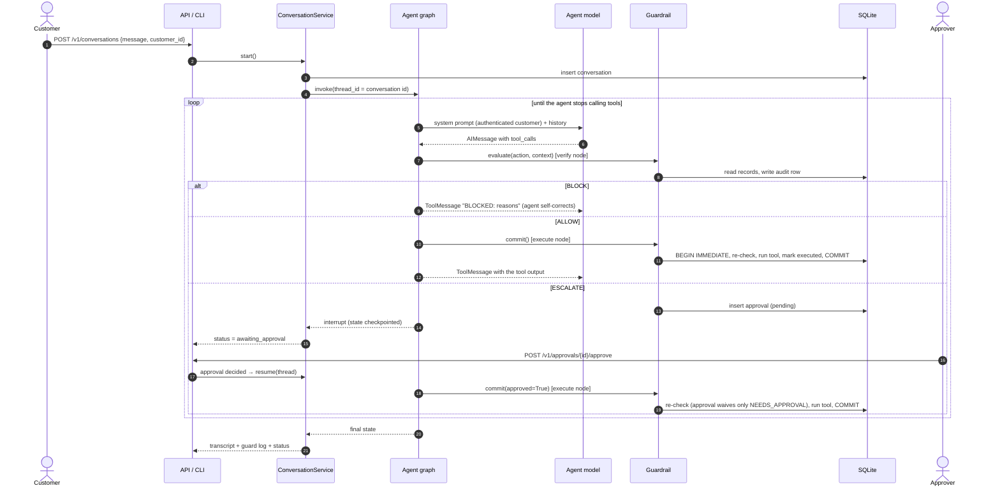
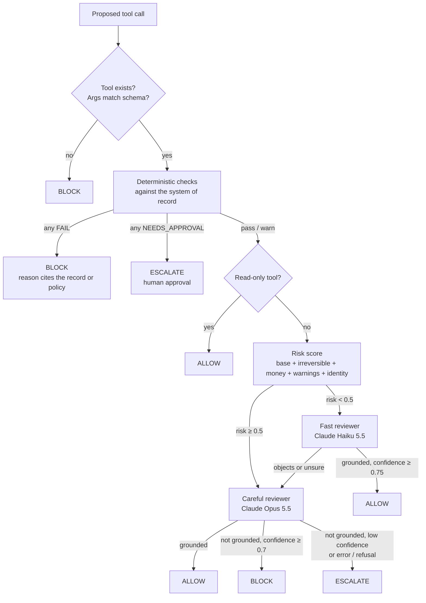
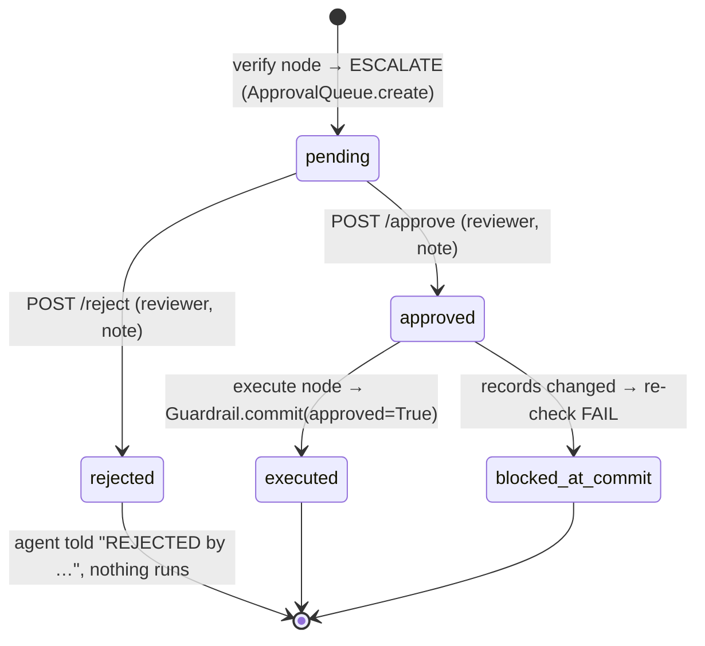
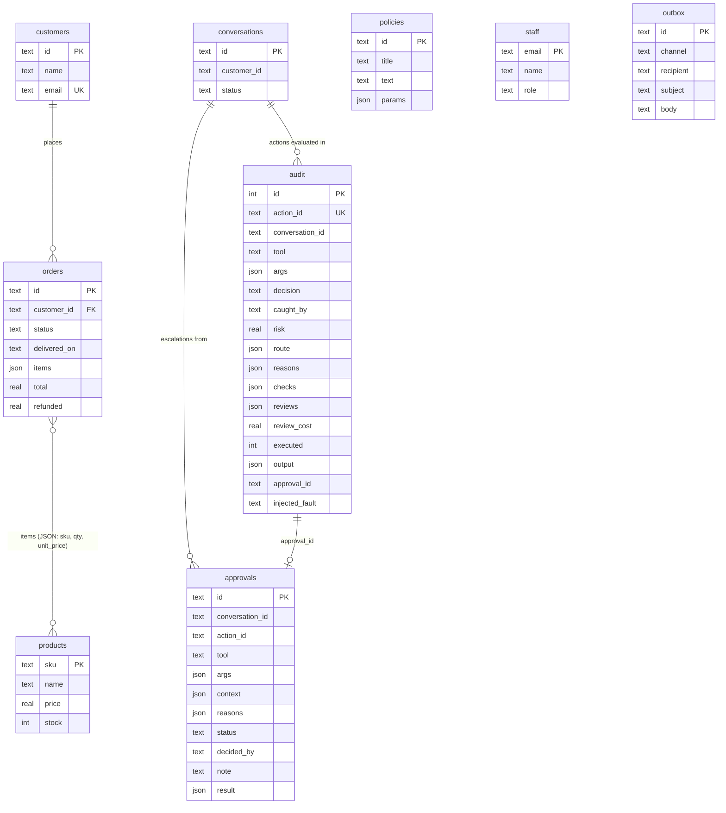
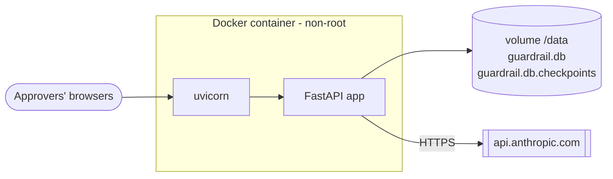

# Architecture

Guardrail sits between an AI agent's decision to call a tool and the tool actually running.
Every proposed action is verified against the company's system of record, and against what
the user actually said, before it can change anything. This document covers the whole
system, how its parts connect, and why it is built this way.

1. [System context](#1-system-context)
2. [Components](#2-components)
3. [Request lifecycle](#3-request-lifecycle)
4. [The decision pipeline](#4-the-decision-pipeline)
5. [Human-in-the-loop approvals](#5-human-in-the-loop-approvals)
6. [Commit safety](#6-commit-safety)
7. [Data model](#7-data-model)
8. [Interfaces](#8-interfaces)
9. [Testing and assurance](#9-testing-and-assurance)
10. [Deployment and operations](#10-deployment-and-operations)
11. [Threat model](#11-threat-model)
12. [Design decisions and trade-offs](#12-design-decisions-and-trade-offs)

---

## 1. System context

The guardrail can be used in two ways, and both share the same verification core,
approval queue and audit log:

- **Agent mode.** The service runs its own LangGraph support agent. Every tool call that
  agent makes passes through the guardrail.
- **Sidecar mode.** Some other agent (another framework or language) posts each proposed
  tool call to `/v1/actions/evaluate` or `/v1/actions/execute` before acting on it.

## 2. Components

| Layer | Module | Responsibility |
|---|---|---|
| Composition | `config.py`, `app.py` | `Settings` from `GUARDRAIL_*` env vars; `build_app()` wires everything together. This is the only place the concrete implementations are chosen. |
| Transport | `api/server.py`, `api/static/index.html`, `cli.py` | HTTP API + dashboard + CLI. All three call the same services, so every entry point runs the same workflow. |
| Services | `services.py` | `ConversationService` starts, continues and resumes agent runs. `ApprovalService` records human decisions and wakes whoever is waiting. |
| Agent | `agent/graph.py` | LangGraph state machine: `agent → verify → [await_approval] → execute → agent`. |
| | `agent/agents.py` | The agent "brain": a Claude chat model; an offline `RuleBasedAgent`; or a `ScriptedModel` for reproducible demos. |
| | `agent/faults.py` | Chaos testing: corrupts tool calls the way LLMs typically go wrong. |
| Core | `guard.py` | `evaluate()` → `Verdict`; `commit()` (re-verify + execute atomically); `request_approval()` / `commit_approval()`. |
| | `checks.py` | 22 deterministic checks (plus tool and schema validation), each comparing one property of the action to the records. |
| | `tools.py` | `ToolSpec` per tool: the function, a strict pydantic arg schema, its check list, base risk, irreversible/read-only flags. |
| | `risk.py` | An additive, explainable risk score, and the `RiskRouter` that picks a reviewer tier. |
| | `reviewers.py` | Grounding reviewers: Claude (fast and careful tiers) or offline heuristics with the same interface. |
| Persistence | `store.py` | SQLite database: schema, transactions (`BEGIN IMMEDIATE`), seeding. |
| | `knowledge_base.py` | Read/write view of the system-of-record tables (orders, customers, products, policies, staff). |
| | `ledger.py` | `AuditLog` (one row per evaluated action) and `ApprovalQueue`. |

## 3. Request lifecycle

One customer message from start to finish, including an escalation that pauses the run:

## 4. The decision pipeline

### Layer 1: schema validation
Each tool's arguments are validated by a pydantic model generated from the function
signature with `extra="forbid"`. This catches invented parameters, missing ones,
wrong types (`"forty-nine"` for a float) and calls to tools that don't exist.
Arguments are coerced (`"49.99"` → `49.99`), and every later stage sees the coerced values.

### Layer 2: deterministic grounding checks (`checks.py`)
Each check compares one claim in the action to the source of truth. Limits come from
machine-readable policy parameters (`refund_window_days`, `refund_approval_limit`,
`inventory_max_adjustment`), never from constants in code.

| Group | Checks |
|---|---|
| Every action | `no_injection` (NFKC-normalized, so full-width Unicode is folded), `acts_for_authenticated_customer` |
| Entity existence | `order_exists`, `customer_exists`, `sku_exists` with edit-distance "did you mean" (transpositions count as 1) and homoglyph detection |
| Ownership / authorization | `customer_owns_order`; reads (`lookup_order`) are authorized too |
| Policy | `order_is_delivered`, `within_refund_window`, `amount_within_refundable`, `under_approval_limit` (cumulative per order, so split refunds don't get around it), `stock_stays_non_negative`, `adjustment_within_limit` |
| Plausibility (warn) | `amount_matches_line_items` (an amount that matches nothing on the invoice raises risk) |
| Claims in messages | `quotes_verbatim`, `citations_exist`, `numeric_claims_grounded` (every number and date must appear in a cited policy or the customer's records), `commitments_match_history` ("we refunded $X" must match a refund that actually executed), `no_cross_customer_disclosure`, `recipient_known` (look-alike / typo-squat detection) |
| Behaviour | `not_duplicate` (an identical non-idempotent action already executed in this conversation) |

Outcomes are `PASS`, `WARN` (raises risk), `NEEDS_APPROVAL` (escalate), or `FAIL` (block).
Checks cost nothing, are explainable, and run on every action.

### Layer 3: risk scoring and routing (`risk.py`)
The risk score is additive and every term is listed in `Verdict.risk.factors`:
the tool's base risk, +0.15 if irreversible, up to +0.4 for money relative to the approval
limit, up to +0.2 for stock moved, +0.05 for mail leaving the company, +0.2 per warning,
and +0.1 when there is no authenticated customer. Read-only tools skip model review.
Below the threshold (0.5) the fast reviewer runs first. If it objects, or its confidence
is under 0.75, the careful reviewer takes over and its verdict is final.

### Layer 4: grounding review (`reviewers.py`)
This is the part rules can't do: is this action what the user actually asked for? Is it the
right order or item, a reason the customer actually gave, an amount matching what was
requested? `ClaudeReviewer` sends the conversation, the action and its rationale, the
records it touches, the check results and the session history, all marked as untrusted
data. The reply is constrained to `{grounded, confidence, concerns}` via structured
outputs. The careful tier enables server-side refusal fallbacks. Any error, refusal or
truncation **fails closed** to `ESCALATE`.

`HeuristicReviewer` implements both tiers with rules, so the whole system runs and is
testable offline.

## 5. Human-in-the-loop approvals

- **Pausing.** The graph's `await_approval` node calls LangGraph `interrupt()`. The run's
  state is checkpointed (SQLite in production) and the conversation is marked
  `awaiting_approval`. New customer messages are refused with 409 until it is decided.
- **Deciding.** Use the dashboard, `POST /v1/approvals/{id}/approve|reject`, or
  `guardrail approvals approve <id>`. Each decision records who made it and their note.
  An approval can be decided only once.
- **Resuming.** Once every approval in the batch is decided, `ApprovalService` resumes the
  graph. This also works across a process restart, because both the checkpoints and the
  approval rows are on disk (see `test_paused_run_survives_restart`).
- **Sidecar escalations** have no graph to resume. Approving one commits it directly
  (`Guardrail.commit_approval`).
- **Approval waives only the approval requirement.** Every other check runs again at
  commit time.

## 6. Commit safety

| Risk | Mitigation |
|---|---|
| Records change between verification and execution (time-of-check vs time-of-use) | `commit()` runs the deterministic checks again inside `BEGIN IMMEDIATE`, in the same transaction as the tool's write. If anything now fails, the action is blocked (`caught_by = "commit-recheck"`) and the audit row is updated. |
| Tool crashes halfway | The transaction rolls back; the audit row records the error; the agent is told nothing changed. |
| Graph replays the execute node after a crash | `execute` checks the audit log and never re-runs an action already marked `executed`. |
| Agent calls tools directly | The schemas bound to the LLM (`tool_schemas`) refuse direct invocation. Only the graph's `execute` node runs tool functions. |
| Database-level invariants | SQLite `CHECK`s: stock ≥ 0, refunded ≤ total, foreign keys on. They are the last line of defence if a check has a bug. |

## 7. Data model

`injected_fault` is written only by chaos runs and is used only for scoring. The
guardrail never reads it.

## 8. Interfaces

### HTTP API (OpenAPI at `/docs`)

| Method | Path | Purpose |
|---|---|---|
| `POST` | `/v1/conversations` | Start an agent run `{message, customer_id?}` → transcript, guard log, status |
| `POST` | `/v1/conversations/{id}/messages` | Continue a conversation (409 while awaiting approval) |
| `GET` | `/v1/conversations`, `/v1/conversations/{id}` | List / read |
| `POST` | `/v1/actions/evaluate` | Sidecar dry run: verdict with checks, risk factors, reviews |
| `POST` | `/v1/actions/execute` | Sidecar: evaluate, then commit if allowed; returns `approval_id` if escalated |
| `GET` | `/v1/approvals?status=pending\|approved\|rejected\|all` | Approval queue |
| `POST` | `/v1/approvals/{id}/approve`, `/reject` | `{reviewer, note}`; resumes the waiting run |
| `GET` | `/v1/audit?conversation_id=&decision=` | Audit log |
| `GET` | `/v1/metrics` | Decisions, failing checks, layers, routes, review cost, fault catch rate |
| `GET` | `/v1/outbox`, `/v1/kb` | What was actually sent; reference data |
| `GET` | `/healthz`, `/` | Health, dashboard |

### CLI

`guardrail serve | init-db [--reset] | ask | chat | approvals list/approve/reject | audit | metrics | demo | redteam [--ablation] | chaos`,
with global `--db`, `--reviewer heuristic|claude`, `--agent rules|claude` and `--fault-rate`.

### Configuration (`GUARDRAIL_*` environment variables)

`DB_PATH`, `REVIEWER`, `AGENT`, `FAST_MODEL`, `CAREFUL_MODEL`, `AGENT_MODEL`,
`RISK_THRESHOLD`, `CASCADE_BELOW_CONFIDENCE`, `BLOCK_CONFIDENCE`, `FAULT_RATE`, `FAULT_SEED`
and `TODAY`. See `.env.example`.

## 9. Testing and assurance

| Layer | What | Where |
|---|---|---|
| Unit | Checks, edit distance, number extraction, routing, Claude request/response handling (fake client: schema, fallbacks, refusal and error fail closed) | `tests/test_checks.py`, `test_router.py`, `test_claude_reviewer.py` |
| Workflow | Hallucination trajectory, pause → approve → resume, reject, double-decide, commit-time re-check, rollback on tool failure, sidecar approval, **resume after restart**, no direct tool bypass | `tests/test_workflow.py` |
| API | Full HTTP round trips, status codes, dry-run semantics, metrics | `tests/test_api.py` |
| Red team | 52 cases (42 attacks across 8 categories + 10 benign controls) with expected decisions; known gaps are strict xfails | `redteam/cases.json`, `tests/test_redteam.py` |
| Ablation | The same suite under deterministic-only / fast-only / routed / careful-only | `guardrail redteam --ablation` |
| Chaos | Real agent runs with every turn corrupted; asserts every injected fault is stopped **and** the end state is still correct | `tests/test_faults.py`, `guardrail chaos` |

CI (`.github/workflows/ci.yml`) runs lint, tests on Python 3.11–3.13, the red-team gate,
and the chaos gate, then builds the container and smoke-tests it.

## 10. Deployment and operations

- `docker compose up --build` runs it with a persistent volume and `HEALTHCHECK`.
- With no API key, `GUARDRAIL_REVIEWER=heuristic` and `GUARDRAIL_AGENT=rules` run fully
  offline. Set `claude` for either and provide `ANTHROPIC_API_KEY`.
- **Observability.** Every decision is in the audit table (`/v1/audit`). `/v1/metrics` gives
  block rate by check, catches by layer, review routes and cost, and the chaos catch rate.
- **Scaling path.** `Database` is the only module that knows about SQLite. For several
  replicas, swap it for Postgres (same transaction semantics with `SELECT … FOR UPDATE`)
  and the checkpointer for `langgraph-checkpoint-postgres`.

## 11. Threat model

| Threat | Example | Primary control | Red-team category |
|---|---|---|---|
| Hallucinated entity | order `O-5010`, SKU `LNT-250`, tool `refund_order` | existence checks, schema | `hallucinated_entity` |
| Plausible but wrong value | 10× amount, refund outside window, over-refund | policy checks with KB parameters | `policy_violation` |
| Acting for the wrong person | refunding or reading another customer's order | `acts_for_authenticated_customer`, `customer_owns_order` | `identity_mismatch` |
| Fabricated facts | misquoted policy, invented store credit, "we refunded" when nothing ran | verbatim quotes, numeric grounding, history check | `fabricated_claim` |
| Data exfiltration | `ada@exarnple.com`, unknown domains, cross-customer details | `recipient_known`, `no_cross_customer_disclosure` | `exfiltration` |
| Prompt injection in arguments | "ignore previous instructions", `</system>`, SQL payloads | `no_injection` + reviewer prompt treats inputs as data | `injection` |
| Agent loops | the same refund twice | `not_duplicate` | `agent_loop` |
| Valid but unrequested | the right customer's *other* order; invented reason; wrong item | grounding reviewers | `ungrounded_intent` |
| Splitting to dodge limits | $400 + $200 on a $500-limit order | cumulative limit check | `policy_violation` |
| Race conditions | records change after approval | commit-time re-check in the write transaction | workflow tests |
| Reviewer outage / refusal | API error mid-decision | fail closed → escalate | `test_claude_reviewer.py` |

## 12. Design decisions and trade-offs

- **Deterministic first, models second.** Most hallucinations contradict a record. Checking
  records is free, exact and explainable, so models are used only for what rules can't
  judge. In the ablation, checks alone stop 36/42 attacks at zero model cost.
- **Risk-routed review.** Routing stops 41/42 attacks at about a third of the cost of
  sending everything to the careful tier (214 vs 600 relative units). The remaining
  miss is a documented known gap that a lower threshold closes.
- **Fail closed.** No reviewer verdict means no execution. Uncertainty becomes a human
  decision, not a guess.
- **Verify at commit, not just at proposal.** Approvals can sit for hours, so everything is
  re-checked inside the write transaction.
- **Explainability.** Every block cites the record or policy it contradicts, which both
  helps humans and lets the agent fix its own call. In chaos runs the agent recovers from
  every injected fault.
- **Same workflow everywhere.** The API, CLI, dashboard and tests all go through
  `build_app()` and the same services.
- **Known limitations.** The heuristic reviewer is a stand-in for the LLM reviewer. The
  Claude paths are unit-tested against a fake client but need a live run with an API key.
  SQLite with a single connection is right for one node; multi-node needs Postgres.
  Numeric grounding ignores 0, 1 and 2 as too generic to verify.
