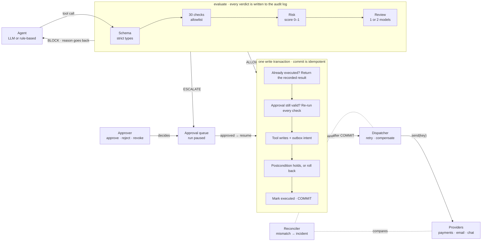

# Prompts for Claude: Round 1 PDF and architecture diagram

Three ready-to-paste prompts for claude.ai (or Claude Code). Prompt A is the one you need for
Round 1: it turns our finished abstract into the PDF. B writes a new abstract from the facts if
you want different wording. C makes only the diagram.

Team details (SaptaX, TM-200031A7855) are already in `ABSTRACT.md`.

---

## Prompt A: typeset the abstract and diagram as the submission PDF

Attach two files to the chat: `ABSTRACT.md` (this folder) and the official problem-statement
PDF (`Perceptron_Hackathon_by_optive_PS_1.pdf`). Then paste:

```text
You are preparing a Round 1 submission for the Perceptron Hackathon 2026 (IITB–Optiver AI
Innovation Lab, Techfest IIT Bombay). Read the attached official PDF first, especially the
"Abstract Format" table, the "Evaluation Criteria" table and "Submission Guidelines".

Round 1 is an online ABSTRACT, not a slide deck: 600–900 words (about 1–1.5 pages) in eight
sections, plus an optional one-page architecture diagram. It is judged on the plan, not code.

Make me a downloadable A4 PDF with exactly this structure:

PAGES 1–2: THE ABSTRACT
- Use the attached ABSTRACT.md text exactly. Do not add claims, numbers, names or tools that are
  not in it, and do not remove any section. Keep the eight section headings in this order:
  Problem & theme chosen; Understanding of the challenge; Proposed approach; Minimum viable;
  Stretch ambitions; Novelty / differentiation; Evaluation plan; Feasibility and risks.
- Title at the top, then one line with team name, Team ID, theme and problem.
- Clean technical typography: a sans-serif such as IBM Plex Sans or Arial, 10 pt body, 1.4 line
  height, section headings small caps or uppercase in a dark blue, justified text, 16–17 mm
  margins. No cover page, no images on these pages. It must fit in 1–1.5 pages.

PAGE 3: ARCHITECTURE DIAGRAM (one page, landscape-friendly, vector if possible)
Title "Architecture", one sentence of intro, the diagram, then a 3-sentence caption.
Draw exactly these boxes and labelled arrows, left to right:
  1. "Agent (LLM or rule-based)" --"tool call"--> a frame labelled
     "evaluate() · every verdict is written to the audit log" containing four boxes in a row:
     "Schema (strict types)" -> "30 checks (allowlist)" -> "Risk (score 0–1)" ->
     "Review (1 or 2 models)".
  2. From the frame, three outcomes, colour-coded AND labelled in words:
     - red "BLOCK · reason goes back": arrow back to the Agent ("the agent fixes its own call");
     - amber "ESCALATE": arrow down to "Approval queue (run paused)"; an "Approver
       (approve · reject · revoke)" box below it with an arrow "decides" up into the queue; then
       an amber arrow "approved → resume" from the queue into the transaction box;
     - green "ALLOW": arrow into the transaction box.
  3. A dashed blue box "one write transaction · commit() is idempotent" with five steps in a
     column joined by arrows: "Already executed? Return the recorded result" → "Approval still
     valid? Re-run every check" → "Tool writes + outbox intent (no provider call)" →
     "Postcondition holds, or everything rolls back" → "Mark executed in the audit log · COMMIT".
  4. Below the transaction box: arrow "after COMMIT" to "Dispatcher (retry · compensate)"
     --"send(key)"--> "Providers (payments · email · chat)". A "Reconciler (mismatch →
     incident)" box with dashed lines to both, labelled "compares".
Caption: "The dashed blue box is the only place anything changes: everything in it happens in
one database transaction, so a check cannot pass on stale records and a crash leaves nothing
half-written. Payments and messages cannot be rolled back, so the tool records them as outbox
intents and the dispatcher delivers them after commit with the intent's id as idempotency key.
The reconciler compares the providers' records with the outbox and audit log."

Colours: green #1f7a4d (allow), amber #9a5b00 (escalate), red #b3261e (block), dark blue
#2c4a8a (the transaction box); everything else dark grey on white. Every arrow has its label.

Before giving me the file: count the words in the eight sections and confirm the count is
between 600 and 900, confirm all eight headings are present in order, and confirm the PDF has
the abstract on pages 1–2 and the diagram on its own page. Tell me any [bracket] placeholders
that are still in the text.
```

---

## Prompt B: write a fresh abstract from the facts (if you want different wording)

```text
Write a Round 1 abstract for the Perceptron Hackathon 2026 (attached official PDF: read its
"Abstract Format" and "Evaluation Criteria" tables first). Theme 6 "AI You Can Actually Trust",
Problem 9 "Catching an Agent Before It Acts on a Bad Idea". 600–900 words, exactly these eight
sections in this order: Problem & theme chosen; Understanding of the challenge; Proposed
approach; Minimum viable; Stretch ambitions; Novelty / differentiation; Evaluation plan;
Feasibility and risks. Precise and concrete, no buzzwords, no invented numbers: use ONLY the
facts below. Team: SaptaX, Team ID TM-200031A7855, members Pratham S (Team Leader), Varsha R, Anjalee. Keep the wording model-agnostic: name model providers at most once.

FACTS
- System: "Guardrail", a service between an agent's decision to call a tool and the tool
  running. Domain: support desk of an outdoor-gear store; 7 tools: issue_refund, send_email,
  answer_customer (chat replies quoting policy), update_inventory, lookup_order, list_orders,
  search_policies.
- Agent: LangGraph state machine agent → verify → await_approval (LangGraph interrupt) →
  execute; Claude Opus 5.5 as the agent. System of record: SQLite (orders, customers,
  products, policies, staff).
- Pipeline: (1) strict schema per tool (rejects invented tools/params, NaN, booleans as
  numbers); (2) 30 deterministic checks written as an ALLOWLIST: each returns PASS, FAIL
  (block), UNVERIFIABLE or NEEDS_APPROVAL (both go to a human); groups: existence/ownership of
  IDs, provenance (every ID, amount, quantity must appear in the user's words or a tool result
  the agent actually received), policy limits read from policy records (30-day refund window,
  $500 per-order approval limit, $600 per-customer 24-hour cap), claim checks on
  customer-facing text (verbatim quotes, grounded numbers, no dropped conditions, no external
  links, no other customers' data), input hygiene (injection, hidden characters, look-alike
  IDs/emails), circuit breaker after 3 blocked attempts; (3) additive explained risk score;
  (4) risk-routed review: Claude Haiku 5.5 below 0.5, Claude Opus 5.5 from 0.5, and from 0.8
  Opus AND Claude Sonnet 5.5 must both approve; reviewers must quote evidence that is then
  found verbatim; timeout/malformed output/refusal fails closed (escalate).
- Commit: allowed and approved actions run in one SQLite BEGIN IMMEDIATE transaction that
  re-checks everything, writes, verifies a postcondition (rolls back otherwise); idempotent
  per action id. Payments and emails are written to an outbox inside the transaction and
  delivered after commit with idempotency keys; failures retried/compensated; a reconciler
  compares provider records with the outbox and audit log.
- Grounding contracts: the service refuses to start if any tool parameter has no named check
  verifying it.
- MVP bullet 1 → four action classes across seven tools verified against records. MVP bullet 2
  → demo: transposed order ID O-5080 blocked ("does not exist; closest real order O-5008"),
  the agent corrects itself; a scripted 9-step hallucinating agent has all 6 bad actions
  stopped. Both stretch goals (risk routing; red-team suite) are implemented.
- ALL RESULTS ARE SIMULATED, NONE LIVE. For every number you use, state its configuration,
  number of cases, and that the agent and reviewers were simulated (the evidence register is
  docs/EVIDENCE.md in the repo):
  - E1 red team: 92 fixed, pre-written proposed actions (75 attacks in 9 categories + 17
    legitimate controls) replayed with NO agent; reviewers = offline rule-based (heuristic)
    stand-ins; each configuration run twice with identical results; "stopped" = blocked or
    escalated. Checks only (model review off) 73/75 stopped, 0/17 false positives, cost 0;
    fast reviewer on all 75/75, 0/17, cost 20; risk routing 75/75, 0/17, cost 98; careful on
    all 75/75, 0/17, cost 720. Cost = simulated reviewer calls weighted fast 1, careful 40
    (list-price ratio), not measured spend.
  - N1–N4, same 92 cases with model review off: 4/4 provenance attacks and 11/11 injection
    attacks stopped; 10/10 unprovable or over-limit attacks escalated to a person.
  - E2 held out: 14 cases (10 attacks, 4 controls) written after the defences BY THE SAME
    AUTHOR; 10/10 stopped now; the code before them allowed 6 of the 10.
  - E3 chaos: the offline rule-based stand-in agent with one tool call per turn corrupted
    (seed 7), heuristic reviewers, 18 conversations, 35 injected faults: 35 blocked, 0
    escalated, 0 executed.
  - E4 scripted agent proposing 9 actions: all 6 bad ones stopped.
  - T5: 229 automated tests pass (11 live-API tests skipped without a key).
  - L1: live Claude agent and reviewers NOT RUN yet.
- Plan to finals: 10–16 Nov live Claude reviewers on the full suite; 17–23 Nov attacks written
  outside the team; 24–30 Nov τ-bench retail tasks as an external benchmark + latency budget;
  1 Dec midway report; 2–14 Dec capability handles (mutating tools accept only references
  returned by real lookups) and demo rehearsal; 15–18 Dec finals.
- Risks: live model judging differently from offline stand-ins; overfitting to our own
  attacks; too many escalations; API outage at the demo (fails closed; offline mode).

After writing, count the words in the eight sections and report the count.
```

---

## Prompt C: only the architecture diagram

```text
Draw a one-page architecture diagram (clean vector style, white background, dark grey lines,
labelled arrows, readable 11–13 px text) for "Guardrail", a pre-execution guardrail for AI
agent tool calls. [Paste the four numbered drawing instructions and the caption from Prompt A
here.] Output it as an SVG file (and a PNG at 2000 px wide). Do not add components that are
not listed.
```

As a rougher fallback (Mermaid's automatic layout is less tidy than `architecture.svg`), paste this into https://mermaid.live:



The same diagram is already drawn in `architecture.svg`, and `build_pdf.py` rebuilds the full
PDF from `ABSTRACT.md` without Claude.
